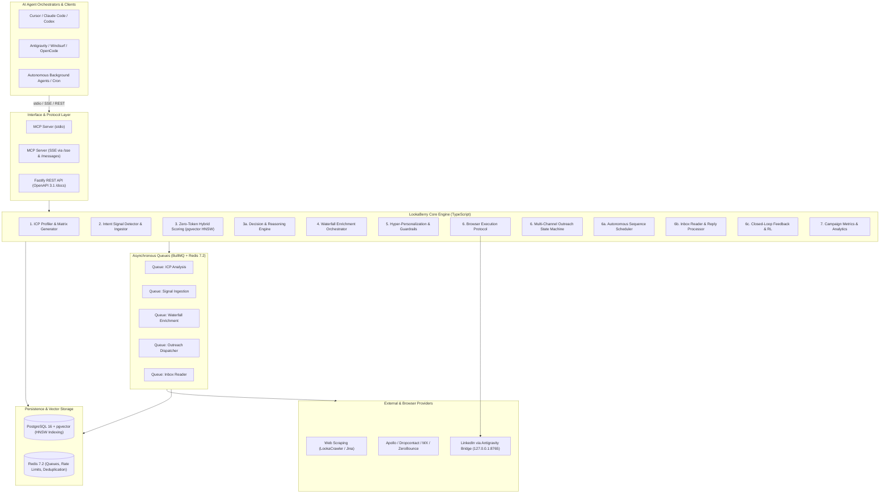

# 🍓 LookaBerry — AI GTM Outbound Engine (API + MCP Server)

> **Open-source (MIT) B2B prospecting API and MCP server for AI agents: ICP analysis, lead scoring in PostgreSQL + pgvector, waterfall enrichment, message drafting and rate-limited outreach. Early stage: no production customers are documented yet.**

[](https://nodejs.org)
[](https://www.typescriptlang.org)
[](https://github.com/pgvector/pgvector)
[](https://modelcontextprotocol.io)
[](https://fastify.dev)
[](https://bullmq.io)
[](https://github.com/lucasmartins-ai/lookaberry/actions/workflows/ci.yml)
[](LICENSE)

---

## 🏷️ Tags & Keywords

`ai-agent` • `model-context-protocol` • `mcp-server` • `gtm-outbound` • `b2b-sales-intelligence` • `pgvector` • `lead-scoring` • `intent-signals` • `waterfall-enrichment`

---

## 📌 Overview

**LookaBerry** is a B2B prospecting engine that AI agents (Claude Code, Cursor, Codex and others) operate through the **Model Context Protocol (MCP)** or a REST API.

### What it does

- **Lead ranking without LLM calls**: ICP fit and intent weighting run in PostgreSQL 16 with `pgvector` (HNSW). Ranking quality depends on the embedding provider; the built-in fallback uses local lexical embeddings, which are weak semantically.
- **LookaCrawler integration**: page content is reduced to Markdown before it reaches a model.
- **Waterfall enrichment**: Cache → Apollo → Dropcontact → SMTP/DNS MX checks. Apollo and Dropcontact need your own credentials.
- **Message drafting**: drafts from the lead's signals and persona. Runs without an LLM API by default (agent mode); Anthropic is optional.
- **Rate-limited dispatcher**: per-account daily quotas, randomised delays (45–210 s) and 48-hour cool-downs. LinkedIn automation runs through a browser extension bridge and may breach LinkedIn's terms; use it at your own risk.
- **Feedback-driven scoring**: interactions (sent, opened, replied, bounced) pause sequences on reply and adjust intent weights with a simple heuristic.
- **Governance tools**: API key lifecycle, RBAC, audit trail, and a suppression list with multi-channel opt-out cascade. These support GDPR/LGPD work; they do not make a deployment compliant on their own. See [SECURITY.md](SECURITY.md).
- **Reliability**: idempotent events, backoff with jitter, dead-letter queue, distributed locks, recovery on restart.

---

## 🗺️ Module status

| Module | MCP tools | Status |
| :--- | :--- | :--- |
| ICP analysis | `gtm_analyze_icp` | Implemented, unit-tested |
| Intent signals and scoring | `gtm_detect_intent_signals`, `gtm_score_and_rank_leads` | Implemented, unit-tested |
| Waterfall enrichment | `gtm_waterfall_enrich_lead` | Implemented; providers need credentials |
| Message drafting | `gtm_generate_hyper_personalized_message` | Implemented, unit-tested |
| Sequences and dispatcher | `gtm_schedule_outreach_sequence` | Implemented, unit-tested |
| Analytics and feedback | `gtm_track_campaign_metrics`, `gtm_record_lead_interaction_feedback` | Implemented, unit-tested |
| Opportunity evaluation | `gtm_evaluate_opportunity` | Implemented, unit-tested |
| Email (Resend/SMTP) | — | Implemented; no unsubscribe header or footer yet |
| WhatsApp | — | Beta |
| Ops dashboard | — | Beta |
| Auth, rate limits, webhook signatures, reliability, governance | — | Implemented, unit-tested |

Known gaps: the signal ingestion queue has no worker yet, and outbound email does not add a `List-Unsubscribe` header or sender footer (opt-out is handled from replies). See [docs/IMPLEMENTATION_STATUS.md](docs/IMPLEMENTATION_STATUS.md).

---

## 🛠️ Complete MCP Tool Catalog

| MCP Tool | Description | Sprint |
| :--- | :--- | :---: |
| [`gtm_analyze_icp`](#gtm_analyze_icp) | Scrapes website, extracts value thesis, and indexes 1536-dim ICP embeddings in pgvector | Sprint 1 |
| [`gtm_detect_intent_signals`](#gtm_detect_intent_signals) | Ingests and detects hiring, funding, and tech signals with calibrated weights | Sprint 2 |
| [`gtm_score_and_rank_leads`](#gtm_score_and_rank_leads) | In-database SQL hybrid scoring `(ICP * 0.4) + (Signal * 0.6)` consuming **0 tokens** | Sprint 2 |
| [`gtm_evaluate_opportunity`](#gtm_evaluate_opportunity) | Deterministic opportunity evaluation: signal (40%) + evidence (25%) + ICP (20%) + seniority (15%) | GTM Brain 2.0 |
| [`gtm_waterfall_enrich_lead`](#gtm_waterfall_enrich_lead) | Cascading enrichment (Cache ➔ Apollo ➔ Dropcontact ➔ SMTP/DNS MX verification) | Sprint 3 |
| [`gtm_generate_hyper_personalized_message`](#gtm_generate_hyper_personalized_message) | Generates grounded B2B outreach with prompt caching and character/word guardrails | Sprint 4 |
| [`gtm_schedule_outreach_sequence`](#gtm_schedule_outreach_sequence) | Schedules multi-channel cadences with human delays and daily quota enforcement | Sprint 5 |
| [`gtm_track_campaign_metrics`](#gtm_track_campaign_metrics) | Aggregates real-time conversion rates (open, click, reply, positive reply, bounce) | Sprint 6 |
| [`gtm_record_lead_interaction_feedback`](#gtm_record_lead_interaction_feedback) | Logs events, classifies sentiment, pauses sequences, and reinforces intent weights | Sprint 6 |
| `gtm_build_lead_delivery` | Final delivery: only leads whose contact has 2 independent confirmations (live re-check + site/company record/identity) and verifiable facts; each with business dossier, sourced facts and grounded approach suggestions. Rejects listed with reasons | Verification gate |

---

### Tool Usage Examples

#### `gtm_analyze_icp`
Extracts target buyer personas, value propositions, and pain points directly from a company website and indexes its vector embedding in PostgreSQL.

```json
{
  "website_url": "https://lookaberry.dev",
  "description": "Autonomous AI GTM Outbound Engine with pgvector",
  "target_geos": ["US", "LATAM", "EMEA"]
}
```

#### `gtm_evaluate_opportunity`
Deterministic opportunity evaluation combining active signals, evidence strength, ICP fit, and lead seniority:

```json
{
  "icp_id": "c87b2f01-5c15-495b-8306-557e227f4115",
  "lead_id": "7aa41bf1-e31a-4e5d-85d2-c7d8d72f4dce"
}
```

#### `gtm_score_and_rank_leads`
Executes hybrid ranking with **zero LLM tokens consumed**:

```json
{
  "icp_id": "c87b2f01-5c15-495b-8306-557e227f4115",
  "limit": 10,
  "min_score": 50,
  "status_filter": "READY"
}
```

#### `gtm_schedule_outreach_sequence`
Schedules a multi-step LinkedIn + Cold Email sequence with anti-ban safeguards:

```json
{
  "campaign_id": "fcad1f47-781c-408d-b4a3-663b9ff5c113",
  "lead_ids": ["7aa41bf1-e31a-4e5d-85d2-c7d8d72f4dce"],
  "steps": [
    { "channel": "LINKEDIN_CONNECT", "delay_hours": 0, "prompt_template": "Hook referencing {{signal.summary}}" },
    { "channel": "EMAIL", "delay_hours": 24, "prompt_template": "Value proposition referencing {{signal.summary}}" }
  ]
}
```

---

## 🏗️ System Architecture



---

## 🧪 Beta walkthrough script

`npm run test:beta` runs a scripted walkthrough of one simulated account (ICP, signals, scoring, enrichment, drafting). It uses mocks, so it shows the flow, not real-world results.

---

## ⚡ Quick Start Guide (Local Setup)

### 1. Prerequisites
- **Node.js**: v22 LTS or higher
- **Docker Desktop**: Running (for PostgreSQL 16 pgvector + Redis 7.2)

### 2. Install Dependencies
```bash
git clone https://github.com/lucasmartins-ai/lookaberry.git
cd lookaberry
npm install
```

### 3. Configure Environment Variables
```bash
cp .env.example .env
```
> **Port Notice**: PostgreSQL runs on port `5433` (mapped from `5432` in container) to prevent conflicts with local database installations.

### 4. Start Database & Redis Cache
```bash
docker compose up -d
```
> Host ports and restart policy are configurable via `.env`: `PG_HOST_PORT` (default `5433`), `REDIS_HOST_PORT` (default `6379`), `COMPOSE_RESTART` (default `always`), `POSTGRES_PASSWORD`, and `BIND_ADDR` (default `127.0.0.1` — ports are not exposed to the network). Update `DATABASE_URL`/`REDIS_URL` if you change them.
>
> Behind a reverse proxy, set `TRUST_PROXY` (proxy IPs/CIDRs, hop count, or `true`) so IP filtering and rate limits see the real client IP; by default `X-Forwarded-For` is ignored.

### 5. Push Prisma Schema & Run Seed
```bash
npm run db:push
npm run db:seed
```

### 6. Start Development Server (REST API + MCP SSE)
```bash
npm run dev
```
- **OpenAPI Swagger UI**: [http://localhost:3000/docs](http://localhost:3000/docs)
- **Health Check Endpoint**: [http://localhost:3000/health](http://localhost:3000/health)
- **MCP SSE Transport**: [http://localhost:3000/sse](http://localhost:3000/sse)

---

## 🤖 Agent-First: No LLM API Required

LookaBerry is a tool for **your** agent (Claude Code, Hermes, Codex, Cursor…). By default (`LLM_MODE=agent`) the server never calls an LLM API:

| Step | Agent mode (default) | Optional server mode |
|---|---|---|
| ICP analysis (`gtm_analyze_icp`) | Returns the reduced page + output format; your agent analyzes it and calls the tool again with `analysis` to save | `LLM_MODE=server` + `ANTHROPIC_API_KEY`, or any OpenAI-compatible `LLM_BASE_URL` + `LLM_MODEL` |
| Messages (`gtm_generate_hyper_personalized_message`) | Returns a brief (lead, signal, conversation memory, facts, limits); your agent writes it and calls again with `draft` — LookaBerry validates guardrails and repetition | same |
| Reply classification | Local pt/en/es heuristic, or the `intent` your agent passes to `gtm_record_lead_interaction_feedback` / `POST /api/v1/events` | same |
| Embeddings (ICP fit, lookalikes) | Local lexical embeddings, no network | `EMBEDDINGS_BASE_URL` + `EMBEDDINGS_MODEL` (LM Studio, Ollama, MLX, OpenRouter…) or `OPENAI_API_KEY` |

After switching embedding providers, run `npx tsx scripts/reembed.ts` so ICPs and companies share one model.

## 🔌 Connecting to AI Agents

LookaBerry is built **AI-Native** and connects seamlessly to any coding agent:

### Option A: Cursor IDE (`.cursor/mcp.json`)
```json
{
  "mcpServers": {
    "lookaberry": {
      "command": "npx",
      "args": ["-y", "tsx", "src/mcp/transports/stdio.ts"],
      "env": {
        "DATABASE_URL": "postgresql://postgres:<password>@127.0.0.1:5433/lookaberry?schema=public"
      }
    }
  }
}
```

### Option B: Claude Code / Antigravity / OpenCode / Codex (`stdio`)
```bash
claude mcp add lookaberry npx -y tsx src/mcp/transports/stdio.ts
```

### Option C: Remote AI Agents via SSE (HTTP)
- **SSE URL**: `http://localhost:3000/sse`
- **Messages Endpoint**: `http://localhost:3000/messages`

---

## 🧪 Testing & Verification

LookaBerry includes a complete multi-tier testing suite:

```bash
# 1. Run the unit tests (no database needed)
npm test

# 2. Run official MCP client smoke test (validating the registered tools)
npm run test:smoke

# 3. Run full end-to-end beta test with test account simulation
npm run test:beta

# 4. Typecheck codebase
npx tsc --noEmit

# 5. Production build
npm run build
```

> **Note**: 4 integration tests require PostgreSQL (127.0.0.1:5433) and Redis (localhost:6379). Unit tests pass without infrastructure; CI runs them on every push.

---

## 📂 Repository Structure

```
LookaBerry/
├── docker-compose.yml       # PostgreSQL 16 (pgvector) on port 5433 & Redis 7.2 on 6379
├── package.json             # Scripts for dev, test, smoke, beta, and database migrations
├── tsconfig.json            # Strict TypeScript ES2022 / NodeNext config
├── vitest.config.ts         # Vitest test runner configuration
├── prisma/
│   ├── schema.prisma        # Complete schema with vector(1536), entity graph & channel fields
│   ├── migrations/          # 6 additive migrations (S1–S4 + GTM Brain 2.0)
│   └── seed.ts              # Rich seed script with demo ICPs, companies, and leads
├── src/
│   ├── config/              # Zod environment variable validation
│   ├── db/                  # Prisma client singleton and pgvector HNSW helpers
│   ├── core/
│   │   ├── icp/             # Scraping engine, LLM Analyzer & pgvector embeddings
│   │   ├── intent/          # Intent signal detector, providers & zero-token hybrid ranking
│   │   ├── decision/        # Deterministic opportunity scoring & action recommendations
│   │   ├── evidence/        # Entity graph—source, person, identity, evidence, observation, relationship
│   │   ├── channels/        # Channel abstraction (ChannelId, ChannelProfile, ChannelRegistry)
│   │   ├── security/        # S15: API keys, RBAC, audit trail, suppression, retention, secrets masking
│   │   ├── enrichment/      # Waterfall enrichment orchestrator with MX verification
│   │   ├── personalization/ # Message synthesizer, static prompt cache & guardrails
│   │   ├── outreach/        # Sequence state machine, human delay & anti-ban rules
│   │   ├── execution/       # Browser Execution Protocol (S5) + Autonomous Loop (S6) + S14 Reliability
│   │   │   ├── adapters/    # LinkedInAdapter, EmailAdapter, WhatsAppAdapter, ManualAdapter
│   │   │   ├── antigravity.ts  # Antigravity Chrome extension HTTP client
│   │   │   ├── router.ts    # ExecutionRouter — routes actions to channel adapters
│   │   │   ├── dispatcher.ts   # BullMQ worker — processes one sequence step at a time
│   │   │   ├── scheduler.ts    # SequenceScheduler — polls for due sequences
│   │   │   ├── inboxWorker.ts  # InboxWorker — reads LinkedIn replies, classifies sentiment
│   │   │   ├── feedbackLoop.ts # FeedbackLoop — delivery verification & intent weight adjustment
│   │   │   ├── idempotency.ts   # S14: Event deduplication & safe replay
│   │   │   ├── backoff.ts       # S14: Exponential backoff with full jitter
│   │   │   ├── dlq.ts           # S14: Dead-Letter Queue
│   │   │   ├── locking.ts       # S14: Distributed locking via pg_advisory_lock
│   │   │   ├── recovery.ts      # S14: Graceful restart & reconnection recovery
│   │   │   └── webhookIdempotency.ts # S14: Idempotent webhook event processing
│   │   ├── analytics/       # Feedback classification & scoring adjustment
│   │   └── queues/          # BullMQ queue definitions and workers
│   ├── mcp/
│   │   ├── server.ts        # McpServer instance & tool catalog
│   │   ├── tools/           # registered MCP tools
│   │   ├── schemas/         # Zod schemas with strict validation
│   │   └── transports/      # stdio and SSE transport entrypoints
│   ├── api/
│   │   ├── server.ts        # Fastify factory with CORS and Swagger UI
│   │   ├── routes/          # /health, /api/v1/icp/analyze, /api/v1/events, /sse, /messages, /webhooks
│   │   └── plugins/         # OpenAPI 3.1 schema documentation
│   └── index.ts             # Server entrypoint with all workers & scheduler
└── tests/
    ├── unit/                # unit tests (run in CI)
    ├── integration/         # Database, Fastify REST API, MCP, evidence, and S14 reliability integration tests
    ├── mcp-client-smoke.ts  # End-to-end MCP client smoke test
    └── beta-test-account.ts # Full beta test suite with test account simulation
```

---

## 📚 Technical Documentation

- [Sprint Roadmap & Next Steps](docs/ROADMAP.md)
- [System Architecture](docs/ARCHITECTURE.md)
- [Data Model & pgvector Schema](docs/DATA_MODEL.md)
- [MCP Tools Catalog](docs/MCP_TOOLS.md)
- [Implementation Status Audit](docs/IMPLEMENTATION_STATUS.md)
- [Intent Providers Architecture](docs/INTENT_PROVIDERS.md)
- [Entity & Evidence Graph Model](docs/EVIDENCE_MODEL.md)
- [Security & Compliance (LGPD/GDPR)](docs/SECURITY_COMPLIANCE.md)
- [Threat Model (S15)](docs/THREAT_MODEL.md)

---

## 📄 License

Distributed under the MIT License. See `LICENSE` for details.